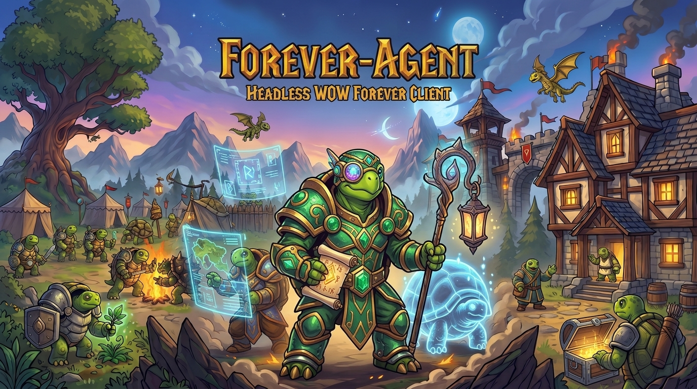

<p align="center"></p>

# forever-agent

forever-agent is a headless **WoW Forever** client for [ForeverCore](https://github.com/Karrz1/TrinityCore)
servers: one process logs one character into the world with no game window and keeps it there. It exposes that
character over a local JSON-RPC socket, so server-side behaviour can be driven and tested from scripts. It is an
unofficial community project, not affiliated with Blizzard Entertainment; use it only on servers you run or are
explicitly allowed to test.

**Status: the Forever client works; the Turtle 1.12 stack is still in the tree** for the Turtle-only commands. Every
command that serves only the old stack refuses a Forever server, and `forever-agent` with no arguments marks each
such line with its Forever replacement.

## What you can do

* Prove that a server's login and world path work: `forever login-check`, `forever world-check`.
* Keep characters in the world and drive them: `forever serve` plus `forever rpc`, or `fleet --forever` for several
  accounts at once.
* Order the server's bot module and run a party through a dungeon (`forever dungeon-play`, `forever dungeon-watch`)
  or a raid (`forever raid-watch`), with a preflight that checks the slot, plan, module and bots first.
* Test a server's bot module over its chat and add-on protocols (`forever tbm-check`, `forever fb-check`).
* Record, replay and score what happened: run traces, combat logs, report cards, scenarios, trials, captures.

## Quick start

You need Go 1.27.4 or newer, a C++17 compiler (the navmesh engine is cgo), and a ForeverCore server you may connect
to. A build without cgo still works, minus path planning. Everything runs on Linux (the slot tools need `/proc` and
`flock`; elsewhere they refuse with exit 2).

```sh
git clone https://github.com/TortoiseBots/forever-agent
cd forever-agent
make build                       # writes bin/forever-agent
bin/forever-agent version        # forever-agent 0.1.0
```

The password comes from the environment, never from a flag and never printed:

```sh
export FOREVER_PASSWORD='<password>'
```

Prove the login path, then the world path (replace the placeholders with your server's addresses, CA file and
account):

```sh
bin/forever-agent forever login-check \
    --rest example.invalid:1119 --rpc example.invalid:1119 --ca ./ca.pem \
    --account ACCOUNT

bin/forever-agent forever world-check \
    --rest example.invalid:1119 --rpc example.invalid:1119 --ca ./ca.pem \
    --account ACCOUNT --character Mychar --stay 20s
```

Start a session you can call, and ask it what it sees:

```sh
bin/forever-agent forever serve \
    --rest example.invalid:1119 --rpc example.invalid:1119 --ca ./ca.pem \
    --account ACCOUNT --character Mychar \
    --password-file ./password.txt --listen 127.0.0.1:8765 --dir ./slot

bin/forever-agent forever rpc ./slot status
```

## Where to read next

The user manual is [docs/manual](docs/manual/index.md), a set of pages with the same shape as the tool: one topic
per page, written for the person using the agent.

| Area | What it covers | Start with |
|---|---|---|
| [Getting started](docs/manual/getting-started/index.md) | What the agent is, build, first login, settings and slots, safety, troubleshooting | [What forever-agent is](docs/manual/getting-started/what-is-forever-agent.md) |
| [The daemon](docs/manual/daemon/index.md) | `forever serve`, RPC calls, world reads, movement, the method index, events | [forever serve](docs/manual/daemon/serve.md) |
| [Player actions](docs/manual/player-actions/index.md) | Spells, items, vendors, quests, trade, mail, chat, groups, pets, `act` steps | [Spells and combat](docs/manual/player-actions/spells-and-combat.md) |
| [Dungeons](docs/manual/dungeons/index.md) | Plans, plan and route tools, preflight, play, watch, stop reasons | [Dungeon plans](docs/manual/dungeons/plans.md) |
| [Bots and raids](docs/manual/bots-and-raids/index.md) | Ordering bots, the add-on protocol, raid watch, fleets, dashboard | [Ordering bots](docs/manual/bots-and-raids/bot-control.md) |
| [Testing](docs/manual/testing/index.md) | How a run is judged, trials, scenarios, bug hunter, report cards | [How a run is judged](docs/manual/testing/overview.md) |
| [Developers](docs/manual/developers/index.md) | Architecture, package map, contracts, adding commands and methods | [Architecture](docs/manual/developers/architecture.md) |

The 1.12 / Turtle stack the repository still carries has its own pages in the same manual, under
[docs/manual/turtle](docs/manual/turtle/index.md); the Turtle history notes stay in
[docs/turtle/README.md](docs/turtle/README.md).

## Project status

What has been run against a real ForeverCore server, and what has only been exercised against a scripted (fake)
world. The manual's [status table](docs/manual/getting-started/what-is-forever-agent.md#what-has-been-proven-and-what-has-not)
is the same list with the details.

| Part | State |
|---|---|
| Login through the Battle.net login server, the world socket, objects, movement, inventory, chat and party, add-ons, death and corpse run, character create and delete | works live |
| The `act` step runner with the item steps | works live |
| Vendor, quest, trainer, flight path, mail, loot and battleground act steps | works against the scripted world; a live run is the next step for each |
| `forever dungeon-play`, `forever dungeon-run --dry`, `forever dungeon-watch`, `forever raid-watch` | works against the scripted world; the live modes are wired, no live dungeon or raid run yet |
| `forever dash-bots` roster dashboard and watch | built; no live run yet |
| The dashboard's 3D view (stage 1: the walkable mesh with markers, live and replay) | built; exercised against a fake serve and a synthetic mesh |
| The trials bench (`forever-agent trials`) | provisions live and drives its situations |
| Navmesh planning (`path_to`, `walk_path`, `forever path-check`) | works offline on a Forever mmaps folder; needs a cgo build |

## Getting help and contributing

* Read [Troubleshooting](docs/manual/getting-started/troubleshooting.md) first: it lists the errors the agent prints
  and the fix for each.
* Questions and bug reports go to the [issue tracker](https://github.com/TortoiseBots/forever-agent/issues); a bug
  report with the command line, the agent's output and the exit code is much easier to act on.
* Code changes: [Contributing](docs/manual/developers/contributing.md) has the checks a change must pass, the branch
  flow and the rules for pull requests. The short form is `make test`, `gofmt`, `staticcheck ./...`, and PRs against
  `dev`; `main` only takes `dev` after review.
* Documentation changes: run `make docs-check` before you push. Every change a user can see updates the manual page
  it changes in the same PR, per [DOCS-SYNC.md](DOCS-SYNC.md); a change with no user-visible effect says `Docs: not
  needed, because ...` in the PR body.

## Licence

GNU Affero General Public License v3.0 or later, see [LICENSE](LICENSE). Versions up to the commit that changed the
licence were released under the MIT License (kept in [LICENSES/MIT-turtle-agent-before-agpl.txt](LICENSES/MIT-turtle-agent-before-agpl.txt));
copies you already received under MIT stay under MIT. Parts are ported from [agent-wow](https://github.com/agent-wow/agent-wow)
(MIT; the files keep their own MIT headers), and `internal/navmesh/detour` is Detour from recastnavigation (zlib,
`internal/navmesh/detour/License.txt`); see [NOTICE](NOTICE). Dungeon event data derived from
[jrad7/mod-dungeon-clear](https://github.com/jrad7/mod-dungeon-clear) (AGPL-3.0-or-later) is marked with its source
where it appears. World of Warcraft is a trademark of Blizzard Entertainment; this project is not affiliated with it.
