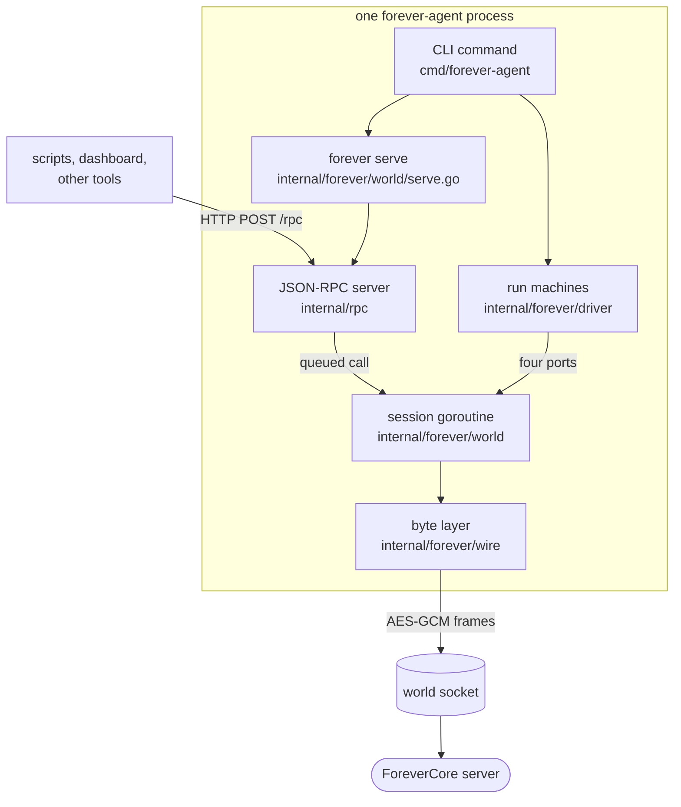

forever-agent is one Go module, `github.com/pjerra/forever-agent`, with three programs: the
`forever-agent` command and two small offline map diagnostics (`liqcheck` and `wcwet`). Everything the agent does with a
server is done by one process that owns one logged-in character: a CLI command either opens that
session itself, or talks to a `forever serve` process that keeps one open.

This page is the map for someone reading or changing the code. It names the layers, the packages
that hold them, and the rules that keep them apart. [Package map](package-map.md) lists every
package in one line; [Adding a command](adding-a-command.md) and
[Adding a daemon method](adding-a-daemon-method.md) show the two most common changes.

# Two protocol stacks in one tree

The repository started as a 1.12 / Turtle client and grew a Forever client beside it. Both stacks
are still built and tested, and each command says which stack it serves:

| Stack | Login and socket | Session | Commands |
|---|---|---|---|
| Forever (Classic 1.60.1) | `internal/forever/bnet`, `internal/forever/worldconn` | `internal/forever/world` | `forever …` subcommands, `forever serve` |
| Turtle 1.12 | `internal/auth`, `internal/worldconn` | `internal/session` | `login` and the commands the help marks `[Turtle only; …]` |

The command scopes live in one map, `commandScopes` in `cmd/forever-agent/command_scope.go`. That
map drives the help text and the refusal a Turtle-only command gives when it is pointed at a
Forever server. A command that is not marked serves both stacks.

Do not copy a packet layout from one stack into the other. The two servers read different
packet shapes even where the opcode names match; a parser belongs to the package for the stack it
was written against.

# The layers

| Layer | Package | What it owns |
|---|---|---|
| Command line | `cmd/forever-agent` | Flag parsing, exit codes, the help text, and choosing between an in-process session and a daemon |
| Login | `internal/forever/bnet` | The HTTPS and Battle.net RPC login, SRP, the realm list, the join ticket |
| World socket | `internal/forever/worldconn` | The handshake, AES-256-GCM frames, the second “instance” socket the server redirects to |
| Byte layer | `internal/forever/wire` | The bit-packed `ByteBuffer`, the 16-byte frame header, 128-bit packed GUIDs, the opcode tables |
| Session and world model | `internal/forever/world` | The single goroutine that reads packets, updates objects, units, party, inventory, quests and the event log |
| Typed wire packages | `internal/forever/<feature>` | One package per feature (`chat`, `loot`, `mail`, `trade`, `quest`, `pet`, …): builders and parsers, no state |
| Daemon | `internal/forever/world/serve.go`, `internal/rpc` | The JSON-RPC socket, the call queue into the session, the reconnect loop |
| Run machines | `internal/forever/driver` | The dungeon run, watch, play and raid-watch state machines |
| Navmesh and plans | `internal/navmesh`, `internal/dungeon` | Path planning on the server's own mmaps, and the dungeon and raid plan format and checks |

The same picture as a flow, for one process:

# The one-goroutine rule

A session is written by exactly one goroutine. In the Forever session (`internal/forever/world`)
that goroutine reads packets from the socket, runs the session methods and appends to the event
log; the RPC HTTP handlers never touch session state. They post a call to the loop and wait for
its result (`serveState.call` in `internal/forever/world/serve.go`).

Two consequences a developer has to remember:

- A blocking method (a walk, a fight, a chat send that waits for a reply) holds the queue. The
  callers' own contexts still cancel, and a call whose caller has gone is dropped before it runs.
- Read-only methods are registered with `serveReadTyped`, so they still answer while the world
  link is down. Everything else is refused at once during a reconnect instead of being queued
  for the session that comes back.

The 1.12 session (`internal/session`) follows the same shape: `Run` is the only goroutine that
writes packets and changes state, and other goroutines queue work for it.

# The daemon and its callers

`forever serve` logs one character in and serves a local JSON-RPC 2.0 endpoint over HTTP
`POST /rpc`. The listener is bound before the login, so a busy address never costs a login
attempt, and it is loopback-only. Authentication is a bearer token unless `--no-auth` is passed;
the daemon's `--dir` mode writes a `slot.json` next to the token file so other tools can find
both. See [serve](../daemon/serve.md) and [RPC basics](../daemon/rpc-basics.md).

Who talks to the daemon:

| Caller | How |
|---|---|
| `forever rpc DIR METHOD [JSON]` | The CLI client; `list` prints the method names (`forever_rpc.go`) |
| `internal/forever/serveclient` | The typed Go client used by the dashboard, preflight and the plan tools |
| `internal/dashboard` | Polls agents' RPC and drives the controls |
| `fleet --forever` | Starts one `forever serve --dir` child per fleet member and checks its slot first |

The run commands take the other road. `forever dungeon-run`, `dungeon-watch`, `dungeon-play`,
`raid-watch`, `bg-watch`, `act` and the `*-check` commands open their own session in the same
process (`world.Enter`, through `foreverCommon.enter` in `forever_chat.go`), because they need the
packets and the model directly while they run rather than a queue in front of them. The run
machines in `internal/forever/driver` talk to that session through four ports, which is what lets
the same state machine run against a scripted fake world in a test.

# What a run writes

A run's evidence is files, not the terminal: a watch writes `<run_id>.forever-run.json`, a
battleground watch `<run_id>.forever-bg.json`, and report cards beside them. Traces
(`internal/trace`, schema `bt-trace` version 1) cover the 1.12 dungeon runs and brain sessions.
The debug packet capture (`--capture-dir`) is a separate, bounded aid; see
[Privacy and captures](privacy-and-captures.md) before you keep one.

# Where to go next

- [Package map](package-map.md) — every package, one line each.
- [Wire and packets](wire-and-packets.md) — how a payload becomes a typed message.
- [Contracts](contracts.md) — the versioned agreements with the bot modules.
- [Adding a command](adding-a-command.md) and [adding a daemon method](adding-a-daemon-method.md).
- [Contributing](contributing.md) — tests, formatting and the pull-request rules.

Further reading outside this manual: the repository's `AGENTS.md`, the decision records under
`docs/adr/`, the design notes under `docs/forever/`, and `docs/CI.md`.
